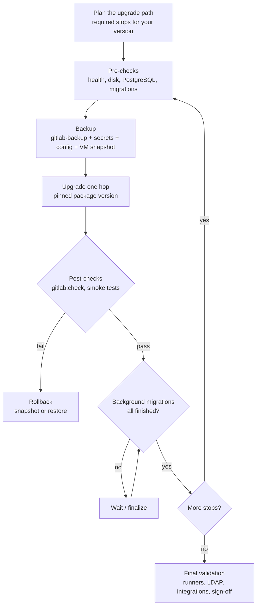

# GitLab Omnibus multi-hop upgrade playbook

**A field-tested runbook for multi-hop self-managed GitLab Omnibus upgrades with zero data loss.**

Old self-managed GitLab instances can't jump straight to the latest release. Each major version has
**required upgrade stops**, database migrations that must finish before the next hop, and bundled
PostgreSQL upgrades along the way. This repo turns that into a repeatable process: plan the path,
gate every hop on evidence, and always keep a tested way back.

## Who it's for

- Platform and DevOps engineers who own a single-node or small Omnibus install that has fallen several major versions behind.
- Teams in regulated environments where every change needs a change request, evidence and a rollback plan.
- Anyone working through a privileged-access bastion or VDI rather than direct SSH.

## The hop workflow

## Contents

| Doc | What it covers |
|---|---|
| [01 Planning the upgrade path](docs/01-planning-upgrade-path.md) | Required stops, maintenance windows, PostgreSQL and OS milestones |
| [02 Pre-checks](docs/02-pre-checks.md) | Health checks, secrets, disk, migrations, backups |
| [03 Hop runbook](docs/03-hop-runbook.md) | The per-hop procedure and the gate before the next one |
| [04 PostgreSQL](docs/04-postgresql.md) | Bundled PostgreSQL upgrades and when to reindex |
| [05 Runners and integrations](docs/05-runners-and-integrations.md) | Runner compatibility, the token workflow, LDAP |
| [06 Rollback](docs/06-rollback.md) | Snapshot vs. backup restore and decision points |
| [07 Evidence and comms](docs/07-evidence-and-comms.md) | What to capture per hop, stakeholder updates |
| [08 Operator safety](docs/08-operator-safety.md) | Working safely through bastions and VDI sessions |
| [Hop checklist](templates/hop-checklist.md) · [Change request](templates/change-request.md) | Copy-and-fill templates |
| [`scripts/precheck-collect.sh`](scripts/precheck-collect.sh) | Read-only evidence collector to run before and after each hop |

## Case study (anonymised)

- **Context:** a regulated financial-services customer running a single-node GitLab Omnibus instance
  several major versions behind (12.x), reachable only through a privileged-access bastion and a VDI.
- **Goal:** reach a supported 19.x release with no data loss, every hop inside an approved
  maintenance window, and evidence for audit.
- **Approach:**
  - Generated the path with GitLab's Upgrade Path tool.
  - Grouped the stops into windows of one to a few hops.
  - Took a VM snapshot plus a `gitlab-backup` before every window.
  - Gated each hop on `gitlab:check` and on background migrations reaching zero.
- **What took time:** waiting for background migrations at certain stops (minutes on some hops, an
  hour or more on others), the bundled PostgreSQL upgrades, and re-registering runners for the newer
  token workflow.

### Lessons learned

1. **Background migrations are the real gate, not the package install.** Starting the next hop with
   migrations still running is the most common way to break an upgrade.
2. **Back up `gitlab-secrets.json` separately and test the restore.** A backup without it can't
   decrypt CI variables, 2FA secrets or runner tokens.
3. **Pin every package version.** "Install latest" from a configured repo skips required stops.
4. **Plan PostgreSQL upgrades as their own milestones,** and reindex if the OS/glibc version changes.
5. **Run everything inside `tmux`/`screen`.** Bastion sessions time out; a migration must not die with
   your session.
6. **Collect the same evidence before and after every hop.** Diffing the outputs makes problems, and
   audit questions, quick to answer.

## Disclaimer

This is general guidance based on public GitLab documentation and field experience. Always confirm
version-specific requirements in the [official upgrade documentation](https://docs.gitlab.com/update/)
for your exact edition and versions.

## License

[MIT](LICENSE)
